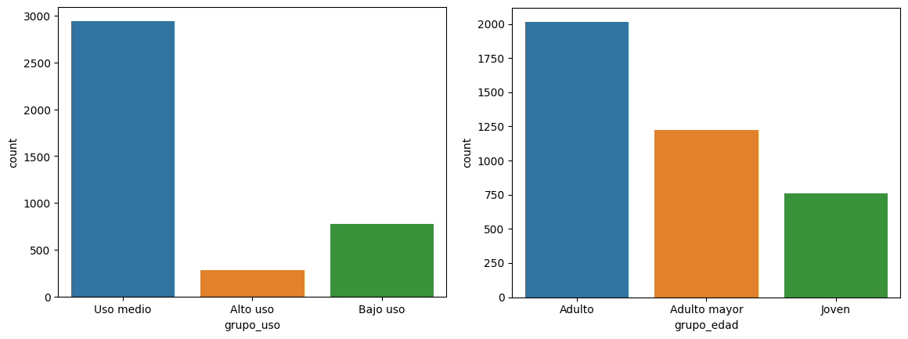
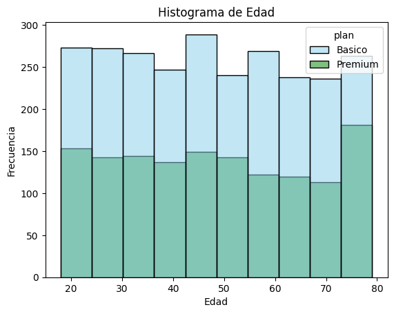
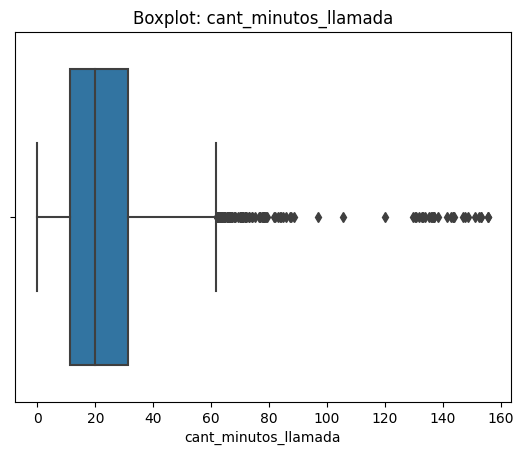

# 📱 ConnectaTel: calidad de datos y segmentación de clientes

Análisis exploratorio de los clientes y el consumo de **ConnectaTel**, una empresa ficticia de telecomunicaciones en Latinoamérica: diagnóstico y limpieza de datos, análisis de patrones de uso y segmentación de clientes para orientar decisiones comerciales.


---

## 🎯 Objetivo

- Detectar y corregir problemas de calidad en los datos de clientes y consumo.
- Entender cómo usan los clientes los servicios de llamadas y mensajes.
- Segmentar a los clientes por **nivel de uso** y por **edad**.
- Proponer acciones comerciales basadas en esos segmentos.

---

## 📂 Estructura del repositorio

```
├── README.md
├── ConnectaTel_analisis.ipynb   # Limpieza, análisis exploratorio y segmentación
└── images/                      # Gráficos usados en este README
```

---

## 🗃️ Datos

| Dataset | Registros | Contenido |
|---------|----------:|-----------|
| `plans.csv` | 2 | Planes Básico y Premium: precio, minutos, mensajes y GB incluidos, y tarifas adicionales |
| `users_latam.csv` | 4.000 | Clientes: edad, ciudad, fecha de registro, plan y fecha de cancelación |
| `usage.csv` | 40.000 | Llamadas y mensajes de 2024: tipo, fecha, duración de llamadas y longitud de mensajes |

---

## 🔍 Metodología

### 1. Diagnóstico de calidad de datos

| Problema | Dónde | Tratamiento |
|----------|-------|-------------|
| Edades con valor centinela **-999** | `users.age` | Imputadas con la mediana (47 años) |
| Ciudades registradas como **"?"** | `users.city` | Marcadas como no disponibles |
| Ciudad faltante (11,7 %) | `users.city` | Se dejan como nulos |
| Fechas de registro en **2026** (fuera del periodo) | `users.reg_date` | Marcadas como nulas |
| Sin fecha de cancelación (88,4 %) | `users.churn_date` | Se mantienen: indican clientes activos |
| Nulos en `duration` (55,2 %) y `length` (44,7 %) | `usage` | Se mantienen: dependen del tipo de registro (las llamadas no tienen longitud y los mensajes no tienen duración) |

### 2. Perfil de uso por cliente
Se agregaron los registros de consumo por cliente (número de mensajes, número de llamadas y minutos totales) y se unieron con los datos de cada cliente.

### 3. Análisis exploratorio
Se usaron histogramas por tipo de plan y boxplots, y se detectaron outliers con el método IQR.

### 4. Segmentación

| Por nivel de uso | Por edad |
|------------------|----------|
| **Bajo uso:** < 5 llamadas y < 5 mensajes | **Joven:** < 30 años |
| **Uso medio:** < 10 llamadas y < 10 mensajes | **Adulto:** 30 a 59 años |
| **Alto uso:** el resto | **Adulto mayor:** 60 años o más |

---

## 📊 Resultados clave

### Segmentación de clientes



- **3 de cada 4 clientes (≈ 2.950) son de uso medio.** Los de alto uso son un grupo pequeño (≈ 280).
- **Los adultos son el segmento más grande (≈ 2.000 clientes)**, seguidos por los adultos mayores (≈ 1.200) y los jóvenes (≈ 750).
- **Adultos y adultos mayores suman cerca del 80 % de la base** y en ambos grupos predomina el uso medio.

### Planes y edad



- El **plan Básico** concentra el 65 % de los clientes y el **Premium**, el 35 %.
- La distribución de edad es bastante uniforme entre 18 y 79 años, pero en el grupo de **73 a 79 años aumenta la proporción del plan Premium**.

### Consumo y outliers



- En promedio, un cliente envía unos **5 mensajes**, hace unas **4 llamadas** y habla unos **23 minutos** en el periodo.
- Los minutos de llamada tienen muchos **outliers por encima de 62 minutos**, con clientes que llegan a unos 156 minutos: un nicho de clientes con consumo muy superior al promedio.

---

## 💡 Recomendaciones

1. **Diseñar planes alineados con el consumo real.** El uso máximo observado (unos 17 mensajes y 156 minutos) está muy por debajo de lo que incluyen los planes actuales (100–500 mensajes y 100–600 minutos).
2. **Crear un plan para el nicho de alto consumo de minutos**, con más minutos incluidos y condiciones diferenciadas.
3. **Enfocar las campañas de fidelización en adultos y adultos mayores**, que son el grueso de la base de clientes.
4. **Mejorar la captura de datos:** validar la edad y la ciudad al registrar clientes para evitar valores como -999 o "?".

---

## ▶️ Cómo reproducirlo

```bash
pip install pandas numpy matplotlib seaborn jupyter
jupyter notebook ConnectaTel_analisis.ipynb
```

> Los datasets se trabajaron en la plataforma del curso (ruta `/datasets/`). Para ejecutar el notebook en otro entorno, ajusta las rutas de carga de los archivos CSV.

---

## 👩‍💻 Autora

**Natalia Viloria** · Data Analyst
📧 natalia.viloria2@gmail.com
